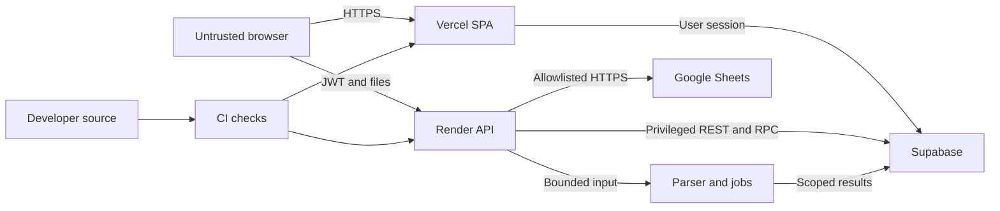

# ADS Veris threat model - 2026-11-13

## Executive summary

The main risks are cross-account access through privileged backend queries,
availability under hostile uploads, and loss of private financial records.
Owner-scoped access, live-session checks, bounded parsers and distributed request
budgets exist. This review adds bounded pre-auth body admission and hardened XML
parsing. It does not establish that every route is secure or certify production
capacity. Recovery and live Auth email configuration remain verification gates.

## Scope and assumptions

- User-confirmed: one account per SME, private financial workbooks, Vercel frontend,
  Render API, Supabase Auth/database/storage; paid AI and payments stay disabled.
- Runtime review: `api/app`, `frontend/src`; configuration and migrations are
  supporting evidence. Local synthetic tests only, no production attack traffic.
- Excluded: provider internals, customer workbook inspection, external pentesting,
  paid upgrades, live recovery and production load campaigns.
- Source baseline: `576fd8e`, with the quality/security changes on
  `codex/platform-quality-20261112`. This is a source-level assessment, not an
  attestation of the current database schema or environment variables.
- Open questions: current confirmation-email delivery/enforcement; proven restore
  location and recovery objectives; acceptable concurrent job workload. Shared
  company accounts/membership would require a revised authorization model.

## System model

### Primary components

- React SPA and Supabase client: `frontend/src/lib/supabase.ts:createClient`.
- FastAPI routes and guards: `api/app/main.py`, `auth.py:get_verified_user`,
  `account_security.py:require_live_session`.
- Data parsing, calculations and cached export: `engine/loader.py`,
  `routes/pipeline.py`; local caches and durable jobs are not the same as backups.
- Privileged REST/RPC access: `dataset_access.py:require_owned_dataset`,
  `commercial_rpc.py:commercial_rpc`, `storage.py:normalize_user_storage_path`.
- Build/test boundary, not runtime: `.github/workflows/ci.yml` runs backend,
  frontend, browser and dependency checks.

### Data flows and trust boundaries

- Browser -> API: HTTPS, bearer JWT, JSON/files/IDs; live session and ownership
  checks, request size/time limits, schema validation. Evidence: `auth.py`,
  `request_security.py`, `dataset_access.py`.
- Browser -> Supabase: HTTPS/WSS, public client key plus user session; database
  policies are essential. A public client key is not a service-role secret.
  Evidence: `frontend/src/lib/supabase.ts`; live policy state was not re-audited here.
- API -> Supabase: HTTPS with privileged credentials; RLS cannot substitute for
  explicit ownership on service-role requests. Evidence: `commercial_rpc.py`,
  `dataset_access.py`, `routes/connectors.py:link_google_sheet_dataset`.
- API -> workbook parser/cache/jobs: untrusted bytes and scoped dataset IDs;
  archive bounds, XML checks and cache identities apply. Evidence:
  `engine/loader.py:validate_source_content`, `routes/pipeline.py:_cache_key`.
- API -> Google Sheets: HTTPS allowlisted download targets with response limits.
  Evidence: `routes/connectors.py:_validate_google_download_url`.
- Developer -> CI -> deployment: reviewed source and dependency locks become
  executable artifacts; CI does not prove live configuration parity.
  Evidence: `.github/workflows/ci.yml`, `api/requirements.txt`.

#### Diagram

## Assets and security objectives

| Asset | Why it matters | Objective |
|---|---|---|
| Workbooks, customer records, exports | Confidential SME financial information | C/I/A |
| Sessions and service-role credentials | Can authorize access or bypass RLS | C/I |
| Metrics and relationship definitions | Decisions depend on correct units and joins | I |
| Plans, credits, admin audit | Entitlements must change atomically and traceably | I |
| API memory, disk, worker slots | Small-instance resources are scarce | A |
| Backups and releases | Recovery and software integrity | C/I/A |

## Attacker model

### Capabilities

An unauthenticated visitor can send HTTP requests. A malicious registered account
can control its own files, labels, IDs, connector requests and request timing, and
can attempt to substitute another account's UUID. Stored workbook cells remain
untrusted even after authentication.

### Non-capabilities

No assumed provider compromise, operator credentials, arbitrary database access
or server shell. Compromise of a developer account is a separate supply-chain
scenario, not an unauthenticated runtime privilege.

## Entry points and attack surfaces

| Surface | How reached | Boundary | Notes | Evidence |
|---|---|---|---|---|
| Account/session requests | Browser/API | Browser-Auth-API | Check active session, not JWT signature alone | `auth.py`, `account_security.py` |
| Upload/clean/analyze/export | HTTP multipart/JSON | Browser-parser | Both size and concurrency matter | `request_security.py`, `engine/loader.py` |
| Dataset, job and cache IDs | API parameters | Tenant-privileged backend | Missing and foreign records must be indistinguishable | `dataset_access.py`, `routes/pipeline.py` |
| Google Sheets import/link | Connector routes | API-external host/database | URL and linked-dataset ownership checks | `routes/connectors.py` |
| Labels and bot output | React rendering | Stored input-browser | Preserve escaping and restrictive CSP | `frontend/vercel.json`, `metric_assistant.py` |
| Administration | Authenticated admin routes | User-admin | Database role and transactional operations | `routes/admin.py`, `commercial_rpc.py` |
| Logs and operational reports | Backend middleware | Runtime-operator | No bodies, tokens or query strings in request logs | `observability.py` |
| Dependencies and release | GitHub CI | Developer-production | Separate from runtime and local scanner artifacts | `.github/workflows/ci.yml` |

## Top abuse paths

1. A registered account substitutes a foreign dataset ID; an omitted ownership
   check on a privileged query could expose or alter another SME's records.
2. A visitor holds many upload bodies open; buffering exhausts resources before
   expensive-job admission can reject the work.
3. A malicious workbook expands compressed/XML content or embeds export formulas;
   insufficient bounds could consume resources or execute spreadsheet actions.
4. A stored label reaches an unsafe HTML sink; browser script steals a persisted
   session and accesses that user's files.
5. Repeated account recovery/registration abuse exploits weak email delivery or
   verification configuration; account access or availability is affected.
6. A user races entitlement/admin writes; a missing transaction or budget permits
   unaccounted changes. Future paid features increase the impact.
7. A connector URL escapes its allowed host set; outbound requests target an
   unintended service or bypass expected data ownership.
8. A compromised release or storage failure corrupts data; an untested backup
   procedure prevents recovery even when analytics snapshots still exist.

## Threat model table

| Threat ID | Threat source | Prerequisites | Threat action | Impact | Impacted assets | Existing controls (evidence) | Gaps | Recommended mitigations | Detection ideas | Likelihood | Impact severity | Priority |
|---|---|---|---|---|---|---|---|---|---|---|---|---|
| TM-001 | Malicious tenant | Valid own account; foreign ID | Bypass dataset ownership | Cross-account disclosure/write | Private files | Owner-filtered lookup and connector guard (`dataset_access.py`, `routes/connectors.py`) | Service-role use still requires consistent checks | Keep negative two-account tests for every new privileged route; verify live RLS independently | Audit denied owner lookups without logging file content | medium: route growth can introduce omissions | high: private financial data | high |
| TM-002 | Remote visitor | Network access | Occupy upload buffers or heavy-job slots | API unavailable | Compute/disk | Size/time limits plus new per-process body semaphore (`request_security.py`); shared write budgets (`request_budget.py`) | Per-process admission is not an edge/global DDoS control | Monitor 408/429 and queue pressure; measure realistic isolated workloads before capacity promises | Status/latency windows (`observability.py`) | medium: cheap requests, bounded effects | medium: availability | medium |
| TM-003 | Malicious tenant | Upload access | Submit hostile archive/XML/formulas | Resource exhaustion or unsafe export | Parser, exports | Archive limits, defusedxml, export neutralization (`engine/loader.py`, `engine/export.py`) | Bounds do not prove every parser dependency safe | Maintain entity/zip/formula regressions and dependency audits | Parser rejection counts, memory peaks | low: layered validation | high: parser or exported-file impact | medium |
| TM-004 | Stored-input attacker | Unsafe rendering regression | Execute script in another user's session | Session/data theft | Sessions/files | React escaping, restrictive script CSP (`frontend/vercel.json`) | SPA client uses default persistent session; XSS still serious | Reject raw HTML sinks; test hostile labels; evaluate HttpOnly architecture separately, not a cosmetic localStorage change | CSP reporting design and browser regressions | low: no demonstrated sink here | high: session access | medium |
| TM-005 | Account attacker | Public Auth endpoints | Abuse weak verification/recovery | Account takeover or lockout | Accounts | Live-session checks and optional/admin MFA (`account_security.py`) | Live SMTP/confirmation state not reverified this pass | Complete actual registration and reset round trips before launch; verify Auth settings | Auth failure and delivery monitoring | medium: live configuration unresolved | high: private account access | high |
| TM-006 | Tenant/admin abuse | Authenticated write access | Race entitlements or suppress audit | Incorrect privileges/credits | Plans/audit | Fail-closed RPC and shared budgets (`commercial_rpc.py`, `request_budget.py`) | Deployment/migration parity not retested here | Preserve transactional tests; keep payments/paid AI off until configured and reconciled | Audit/operation mismatches | low: transactional controls | high: privilege/financial effects | medium |
| TM-007 | Connector user | Import permission | Redirect a fetch or link foreign data | SSRF or crossed ownership | API network/files | Host validation and ownership guard (`routes/connectors.py`) | External host behavior can change | Retain redirect/host/owner regression tests and response limits | Rejected connector targets without tokens | low: explicit validation | high: data/network access | medium |
| TM-008 | Operator error or compromised release | Storage/deployment access or failure | Destroy/corrupt durable data | Irrecoverable customer loss | Files/database/releases | CI checks; restore snapshots in application | Full off-provider restore drill deferred by user | Complete encrypted backup and isolated restoration before storing irreplaceable data; maintain protected releases | Backup freshness and restore verification | medium: operational failures are realistic | high: durable data loss | high |

## Criticality calibration

- Critical: demonstrated unauthenticated bulk tenant export; unauthenticated
  service-role credential disclosure with broad access. Neither established here.
- High: cross-tenant owner-check bypass; account recovery takeover; unrecoverable
  customer storage loss.
- Medium: bounded targeted upload DoS; an export injection requiring a workbook
  opened by the victim; stale/mis-scoped analytics without raw data disclosure.
- Low: cosmetic state disclosure without sensitive data; misleading non-sensitive
  status copy with no authorization or integrity consequence.

## Focus paths for security review

| Path | Why it matters | Related Threat IDs |
|---|---|---|
| `api/app/auth.py`, `account_security.py` | Session validity and privileged assurance | TM-001, TM-005 |
| `api/app/dataset_access.py`, `storage.py` | Ownership before privileged storage/database use | TM-001 |
| `api/app/routes/pipeline.py` | Cache identities, exports and asynchronous work | TM-001, TM-002, TM-003 |
| `api/app/engine/loader.py`, `export.py` | Hostile files in, safe spreadsheet data out | TM-003 |
| `api/app/routes/connectors.py` | External requests and dataset linking | TM-001, TM-007 |
| `api/app/commercial_rpc.py`, `routes/admin.py` | Atomic entitlements and admin checks | TM-006 |
| `api/app/request_security.py`, `request_budget.py` | Resource admission and distributed budgets | TM-002 |
| `frontend/src/lib/supabase.ts`, `frontend/vercel.json` | Browser session and script boundary | TM-004, TM-005 |
| `.github/workflows/ci.yml` | Regression/dependency gate before release | TM-008 |

## Notes on use

Entrypoints discovered in this pass and every listed boundary are represented
above. Runtime, CI and local development tools are separated. Assumptions were
confirmed by the user; unresolved live settings are stated explicitly. Threats
are plausible review priorities, not claims of successful exploitation. Semgrep
is complementary pattern analysis, not evidence that all authorization paths or
provider configuration are correct. Revisit this model for organizations, payments,
paid AI, additional connectors or a changed hosting architecture.
